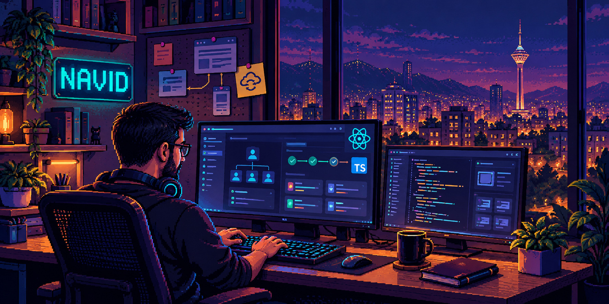

# Navid Talebi

**Senior Front-End Engineer · React & TypeScript**

I build web applications that turn complex business workflows into usable, maintainable software. My experience spans enterprise platforms, e-commerce and interactive content tools, with end-to-end responsibility for architecture, feature delivery and ongoing maintenance.

[LinkedIn](https://www.linkedin.com/in/navidtalebi/) · [Email](mailto:navid.talebe@gmail.com)

## Engineering ownership

- **Architecture to delivery.** Built and own an enterprise platform's front end as its sole front-end engineer, supporting thousands of employees through reusable components and integrated applications.
- **Complex workflows.** Translate requirements across business units into forms, approval flows, employee services, dashboards and reporting tools connected to REST APIs.
- **Performance & PWAs.** Implement route-based code splitting, build optimizations, offline caching and push notifications with Workbox.
- **Interactive experiences.** Build organizational charts, assessments and digital reading tools; earlier work includes a drag-and-drop editor and e-commerce administration interfaces.

## Core toolkit

| Area | Primary tools |
| --- | --- |
| Interface engineering | React, TypeScript, JavaScript, Next.js, HTML, CSS/Sass |
| Application state & data | TanStack Query, Redux Toolkit, REST APIs |
| Build & delivery | Vite, Workbox, Git |

## Product thinking & applied AI

Formal product management training complements my engineering work: understanding the workflow, shaping the interface and carrying it through delivery.

I've prototyped semantic search with a retrieval service, feature flags and a standard-search fallback. I also use Codex and Claude Code for AI-assisted development. My current interests include applied AI and product engineering.

<strong>Foundations & professional development</strong>

- **Product management:** 160+ hours of training at Quera.
- **AI foundations:** completed Rahnema College's machine learning program; foundational knowledge of deep learning, NLP and LLMs.
- **DevOps foundations:** Docker, Docker Compose, CI/CD concepts and application deployment fundamentals, supported by foundational training at Sematec.
- **Education:** BSc in Electrical Engineering, Isfahan University of Technology.

Most of my professional work lives in private repositories. This profile focuses on the engineering experience I can share publicly.
